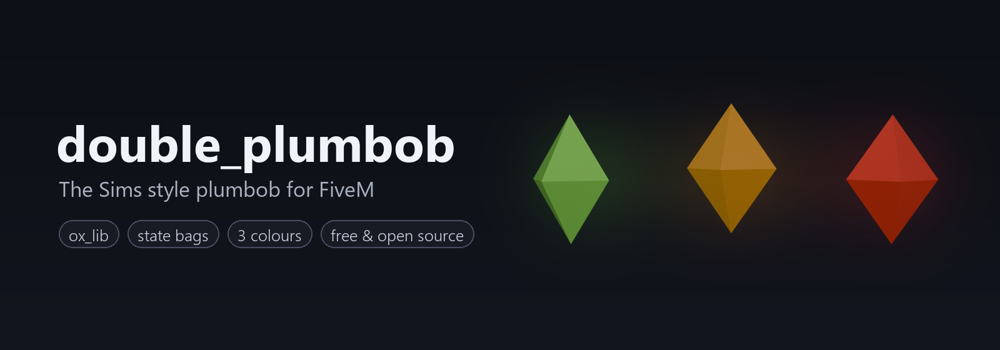

# double_plumbob

**The Sims style plumbob for FiveM.** A small glowing diamond that floats and spins above a player's head,
visible to everyone around them.

Originally made for the FeelAlrightRP server, now free and open source.

## What is it for?

A plumbob is a quick visual signal that everybody understands at a glance, without chat messages or UI.
Some ways servers use it:

- **New players**: green plumbob for the first hours on the server, so others know to go easy on them
- **Roleplay status**: green = open for RP, orange = busy, red = do not disturb / OOC
- **AFK / paused**: show it automatically from your AFK script through the exports
- **Staff on duty**: mark admins or helpers in the city so players know who to ask
- **Events and games**: teams, the "it" player in tag, hide and seek, race leaders, quiz winners
- **Jobs**: highlight a customer waiting for a taxi, a patient waiting for a medic, a suspect in a chase scenario
- **Just for fun**: let players toggle it themselves from the menu

## Features

- **Three colours out of the box**: green, orange and red, all with their own streamed model
- **Synced for everyone** through player state bags: players who come into range see it immediately,
  nothing is lost when someone leaves and comes back
- **Player menu**: `/plumbob` opens an ox_lib menu to show, hide or change colour
- **Admin command**: control any player's plumbob from in game or from the server console
- **Exports** on both client and server, so any other resource can drive it
- **Secure**: the server validates everything clients send (known colours only, cooldown against spam);
  clients cannot write the state themselves
- **Lightweight**: ~0.00 ms when no plumbob is near you, one small loop when there is
- **Smooth**: not attached to the head bone, so it does not shake with animations; spin and bob speed do not
  depend on FPS
- **Framework independent**: works with ESX, QBox, QBCore or standalone
- **Configurable**: command, permissions, height, animation, colours and all texts in one `config.lua`
- **Extendable**: Blender source and build script included, add your own colours

## Preview

Screenshots and video coming soon.

## Requirements

- [ox_lib](https://github.com/overextended/ox_lib)

## Installation

1. Download the [latest release](https://github.com/DoubleCZ/double_plumbob/releases/latest) and put the
   `double_plumbob` folder into your `resources`.
2. Add to `server.cfg` after ox_lib:
   ```cfg
   ensure ox_lib
   ensure double_plumbob
   ```
3. Allow your admins to control other players' plumbobs:
   ```cfg
   add_ace group.admin plumbob.admin allow
   ```

## Commands

| Command | Who | What it does |
|---|---|---|
| `/plumbob` | everyone¹ | Opens the menu (show, hide, change colour) |
| `/plumbob <id>` | admin, console | Toggles the plumbob of that player |
| `/plumbob <id> <colour>` | admin, console | Shows it in that colour (`green`, `orange`, `red`) |
| `/plumbob <id> hide` | admin, console | Hides it |

¹ Set `Config.AllowSelfToggle = false` and only admins can use it.

## Exports

### Server

```lua
exports.double_plumbob:Show(source, 'red')   -- colour is optional, keeps the current one
exports.double_plumbob:Hide(source)
exports.double_plumbob:SetColor(source, 'orange')
exports.double_plumbob:GetColor(source)      -- 'green'
exports.double_plumbob:IsShown(source)       -- true / false
```

`Show` and `SetColor` return `false` for an unknown colour.

Example, an orange plumbob while a staff member is on duty:

```lua
local function setDuty(source, onDuty)
    if onDuty then
        exports.double_plumbob:Show(source, 'orange')
    else
        exports.double_plumbob:Hide(source)
    end
end
```

### Client (local player)

```lua
exports.double_plumbob:Show('green')
exports.double_plumbob:Hide()
exports.double_plumbob:SetColor('red')
exports.double_plumbob:GetColor()
exports.double_plumbob:IsShown()
```

Client exports go through the server, so they follow `Config.AllowSelfToggle` and the cooldown.

### State bag

The current state can be read from anywhere:

```lua
Player(source).state.plumbob     -- server
LocalPlayer.state.plumbob        -- client
-- { active = true, color = 'green' }
```

Only the server writes it.

## Configuration

Everything is in [`config.lua`](config.lua):

| Option | Default | Description |
|---|---|---|
| `Command` | `'plumbob'` | Command name |
| `AdminAce` | `'plumbob.admin'` | Ace needed to control other players |
| `AllowSelfToggle` | `true` | Players can show / hide / recolour their own plumbob |
| `Cooldown` | `750` | Minimum ms between two requests from one player |
| `DefaultColor` | `'green'` | Colour used when none was chosen |
| `Colors` | green, orange, red | Colour name, menu label and model |
| `Bone` / `Offset` | head, 0.45 m | Where above the player it floats |
| `Animation` | on | Spin speed, bob height and bob speed |
| `Locale` | English | All menu and notification texts |

## How it works

The server stores `{ active, color }` in the player's state bag. Every client watches that state bag and spawns
a local, non-networked prop for each player in range who has the plumbob on. A single loop moves those props
above the players' heads each frame and sleeps when there are none. When a player leaves scope, their prop is
removed and comes back as soon as they are in range again.

## Adding a colour

1. Add `_source/textures/plumbob_<colour>.dds` (256×256, DXT1).
2. Add the colour to `COLORS` in `_source/build.py` and rebuild the model (see below).
3. Add it to `Config.Colors` in `config.lua`.

## Building the model

The files in `stream/` are built from `_source/double_plumbob.blend` with [Blender](https://www.blender.org/)
4.2+ and [Sollumz](https://github.com/Sollumz/Sollumz) 2.8+. Native export needs PyMateria, which is Windows only.

```
blender -b _source/double_plumbob.blend --python _source/build.py
```

## FAQ

**I see nothing above the head.**
Make sure the resource is started after ox_lib and that `stream/` contains the `.ydr` files and
`double_plumbob.ytyp`. Look in F8 for `model for colour "..." is not streamed`.

**Can players see their own plumbob?**
Yes, everyone sees it, including the owner.

**Does it work in vehicles?**
Yes, it follows the player's head wherever they are.

**Will it stay after a restart or relog?**
No, the state lives only as long as the player is connected. Use the server exports on join if you want it
to persist.

## Support

Found a bug or have an idea? Open an [issue](https://github.com/DoubleCZ/double_plumbob/issues).

## License

[MIT](LICENSE). Use it, change it, ship it on your server. A link back is appreciated.

Not affiliated with or endorsed by Electronic Arts or Maxis. "The Sims" is a trademark of Electronic Arts Inc.
